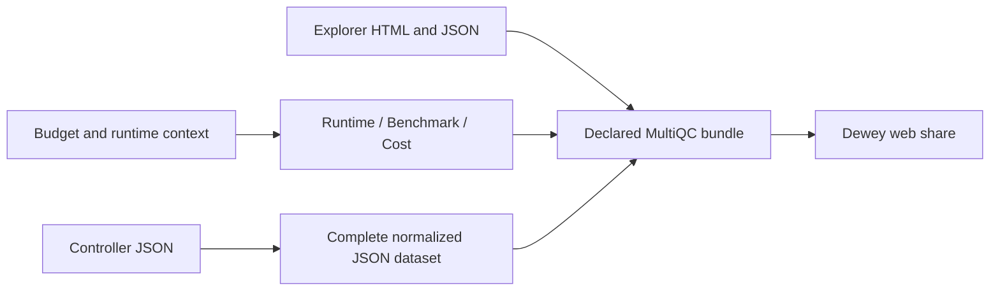

# Controller JSON and portable runtime reports

Controlling ledger: /Users/jmajor/.codex/worktrees/results-mirror-ursa-integrated/daylily-ursa/docs/plans/20261109T090658Z_ursa_improvements_implementation_ledger.md

## Current continuation state

Published 1.37.0 implements the requested JSON-only configuration report and dedicated Runtime / Benchmark / Cost section. Publication and downstream deployment are separate. Tests were not run, following the user release policy. Existing parser/module fixtures were adapted to JSON record inputs.

The snakemake_samples module reads only controller_analysis_units_inputs.json. It exports the entire typed document, including settings, unused fields, nulls and provenance, as multiqc_dayoa_controller_analysis_units_inputs and includes it in the rendered report. Entity datasets use JSON; scientific QC result TSVs remain supported. There is no configuration TSV search or ingestion path.

DayOA supplies dayoa_runtime_context through report configuration. MultiQC exports multiqc_dayoa_runtime_benchmark_cost and renders the dedicated linked section. Explicit report_files are copied into the native paginated bundle and included in its file manifest. Marked report-relative links are rebased for nested section pages. No URLs are discovered, signed, or uploaded by MultiQC.

Downstream: DayOA must select this immutable release through a new environment filename, place the companions inside its declared final report assets tree, and preserve their links when packaging renames the report. Ursa's existing declared assets-directory collection includes those files. Runtime acceptance remains pending; source changes are not evidence of a completed report or share.

## Execution command dataset (1.37.1)

The requested command provenance extension consumes explicit `dayoa_execution_context.json` and preserves the document in `multiqc_dayoa_execution_context.json` and the `multiqc_data.json` raw-data collection. The Complete controller configuration section displays the shell-quoted `dy-r` invocation and expandable execution metadata. No additional report group or scientific input format is introduced.

The `dayoa.execution_context.v1` document contains `analysis`, `attempt_id`, `attempt_sequence`, `origin`, `mode`, `command_captured_at`, `requested_command`, optional `dyec_catalog_key`, and `dy_r`, `wrapper`, `workflow_engine` objects. Each command object contains `command` and `argv`. `argv` preserves exact argument boundaries; `command` is its POSIX shell-quoted representation, not the original terminal text. It is invocation provenance, not a terminal success result. Absent catalog provenance is null, never inferred from targets or filenames. Dry and live reports identify their own attempt; historical native status retains previous attempts.

DayOA 22.0.6 produces and stages this file for final WGS and all supported run-QC reports, and names it in analysis manifests. DYEC 24.0.12 passes its selected command key through the wrapper. Source publication and the authorized Ursa native campaign remain separately tracked in the controlling ledger. No pytest, lint, or extra verification campaign was run.

## Somalier contamination (1.37.2)

November 10 scoped request: add contamination only at existing Somalier executions. The native Somalier module now exposes `contamination_charr` as a percent in its table and `contamination_charr_n_sites` as the usable-site count. The normalized dataset keeps the native fraction unchanged. Native nonfinite values remain missing, never zero or a QC disposition. No new Somalier invocation or pass/fail threshold is introduced.

DayOA passes the matching existing sites panel to its existing relate calls and stages their native samples tables. Separate assay records remain separate. QEO2 consumes the normalized native table through its explicit Somalier adapter. Source publication is separate from the pending Ursa campaign. Tests and lint remain off under user policy.
