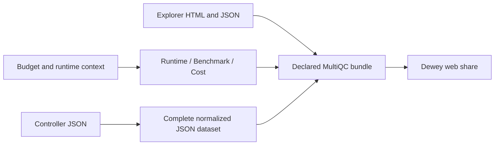

# Controller JSON and portable runtime reports

Controlling ledger: /Users/jmajor/.codex/worktrees/results-mirror-ursa-integrated/daylily-ursa/docs/plans/20261109T090658Z_ursa_improvements_implementation_ledger.md

## Current continuation state

Source changes for 1.37.0 implement the requested JSON-only configuration report and dedicated Runtime / Benchmark / Cost section. Publication and downstream deployment are separate. Tests were not run, following the user release policy. Existing parser/module fixtures were adapted to JSON record inputs.

The snakemake_samples module reads only controller_analysis_units_inputs.json. It exports the entire typed document, including settings, unused fields, nulls and provenance, as multiqc_dayoa_controller_analysis_units_inputs and includes it in the rendered report. Entity datasets use JSON; scientific QC result TSVs remain supported. There is no configuration TSV search or ingestion path.

DayOA supplies dayoa_runtime_context through report configuration. MultiQC exports multiqc_dayoa_runtime_benchmark_cost and renders the dedicated linked section. Explicit report_files are copied into the native paginated bundle and included in its file manifest. Marked report-relative links are rebased for nested section pages. No URLs are discovered, signed, or uploaded by MultiQC.

Downstream: DayOA must select this immutable release through a new environment filename, place the companions inside its declared final report assets tree, and preserve their links when packaging renames the report. Ursa's existing declared assets-directory collection includes those files. Runtime acceptance remains pending; source changes are not evidence of a completed report or share.
